# Tunisia
:octicons-calendar-24: October, 2026

6 days of road tripping through sunny Tunisia without a single resort stop! We explored the interior of the country and also stopped by the coast for a sea dip. This trip took place in October 2026- 2 women (24 and 26 yo). 

Before you start, here was our itinerary: 
  

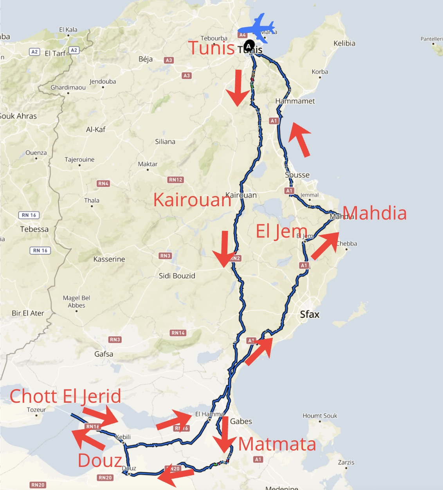

## Day 1: Arrival in Tunis & Tunis/Carthage
<u>Arrival in Tunis:</u> 

Arrived in Tunis fairly late- there is a surcharge for taxis but cost us 30 dinars for a 10 min trip into the centre. We picked up some dinars at the airport (There are ATMs as you exit - STB is the best* see top tips below). 

We stayed at [this place](https://www.booking.com/hotel/tn/bedroom-in-the-city-center.fr.html?aid=356980&label=mkt123sc-b7e534f9-6c87-4e3d-91a7-ed88d94861c4&sid=dcfb1164d3f7d35d911f62685d8651d8&dest_id=-731701&dest_type=city&dist=0&group_adults=2&group_children=0&hapos=1&hpos=1&no_rooms=1&req_adults=2&req_children=0&room1=A%2CA&sb_price_type=total&sr_order=popularity&srepoch=1792143891&srpvid=74fc4487fe95009c&type=total&ucfs=1&) (it's a hostel/room), but would only recommend if you’re looking for cheap accommodation. It was a 20 minute walk into the centre (medina, Clocktower), quite basic and a bit loud at night (from the women’s room).  

<u>Next day in Tunis and Carthage:</u> 

The next day we headed to the centre of Tunis to catch a train to see Carthage. We had a quick coffee and pastry (10 dinars each on a main street). 

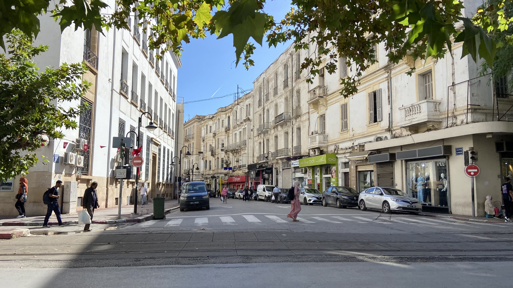

To get to Carthage we took the [TGM train](https://destination-tunis.fr/se-deplacer/tgm-tunis-carthage-la-marsa/) from Tunis Marine. It comes every 30-40 minutes, and cost us 0.8 TND each (800 in coins). We got off at Carthage Hannibal and walked to the Cathedral to get tickets (20 TND each and could be used for all of the sites). We then had time to see the Roman villas and Thermes d'Antonin. Took us about 2 hours for the whole loop. Good self-walking tour guide I found [here](https://www.gpsmycity.com/tours/carthage-walking-tour-2987.html). 

We then hopped back on the train to get to Sidi Bou Saïd (you have to buy another ticket but can buy it from the controller, cost us a bit less this time, 0.5 TND each). It was very touristy- lots of people trying to sell you things but we got a chapati [here](https://maps.app.goo.gl/ZAXwEHu3gk5RegTE8), and went to sit with a nice view [here](https://maps.app.goo.gl/BieB1cmVKBhhbx2AA). We then walked down [via this route](https://maps.app.goo.gl/FLVPQiSk4Ut1AiBu9) towards La Marsa to wander the beach (lots of locals fishing and playing volleyball). The train back from La Marsa cost us 0.8 TND each to get back to Tunis Marine. Had dinner at a local food place on the street - lots around and open quite late. 

![thermescarthage] (images/tunisia/thermes.jpeg){data-gallery="my-gallery"}
![sidimarsa] (images/tunisia/road siditomarsa.jpeg){data-gallery="my-gallery"}
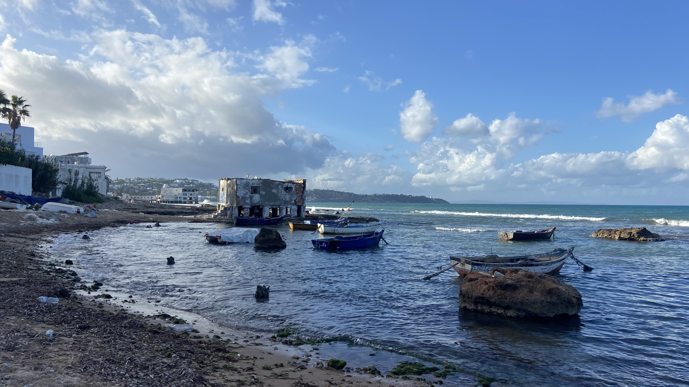{data-gallery="my-gallery"}

## Day 2: Tunis to Kairouan (Kerouan)
On this morning we picked up the car from the airport. We got a taxi there for 6 TND total. We had looked into getting a bus to the airport but it is slightly complex because it leaves from Tunis Marine which was a 20 minute walk for us with bags- and taxi ended up being very cheap anyways! 

We had rented the car here at [Tunisia Rent Car](https://maps.app.goo.gl/X2qqBjuwJcpXHVAW9). It was 160€ for the car rental with insurance included. They were super helpful and even let us bring the car back 4 hours past the return time. 

The drive from Tunis to Kairouan took about 2h30 and we weren’t on the highway the whole time. Could have easily stopped for some food/drinks at any cafe on the side of the road if we wanted to. 

Kairouan was a bit "tourist-crazy" when we arrived. As soon as we got out the car people were trying to give us guided tours of the city. We ended up paying a 20 TND ticket for all the large sites in the city (NB: the [Basins of Aghlabides](https://maps.app.goo.gl/GU282BqEqw4Z6iWT8) are closed this year). 

We started with the Great Mosque which was beautiful but can’t see the interior. We then headed into the medina (NB: people will try to get you to come to their rooftop/see their carpets/get coffee). We stopped by the [Governor’s House](https://maps.app.goo.gl/GonftHPicx7jKxk89). It isn’t an official site visit and they try to sell you carpets or make you pay for a visit but nice nevertheless. We then walked around the souk and to the [Sidi Abid el Ghariani Mausoleum](https://maps.app.goo.gl/U6pNEb76WiiWtrZf6), which was beautiful and completely empty. 

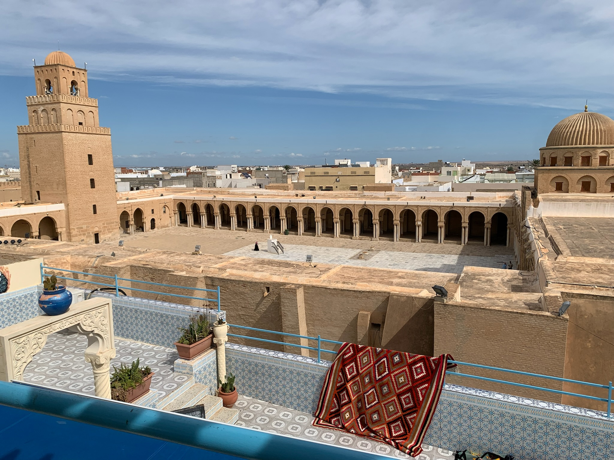{data-gallery="my-gallery"}
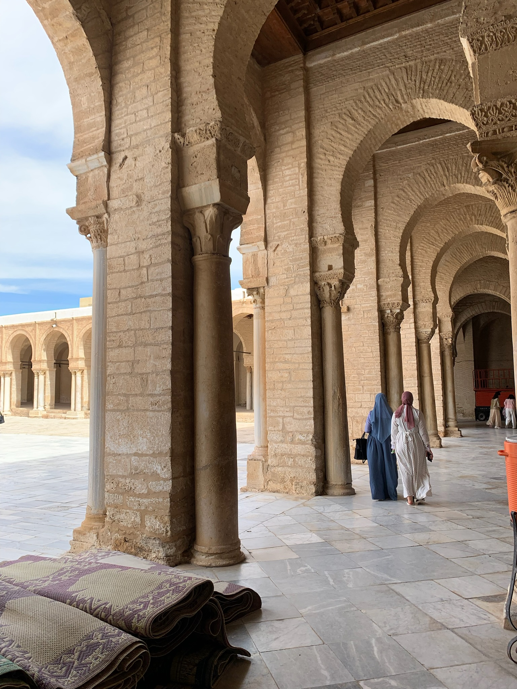{data-gallery="my-gallery"}
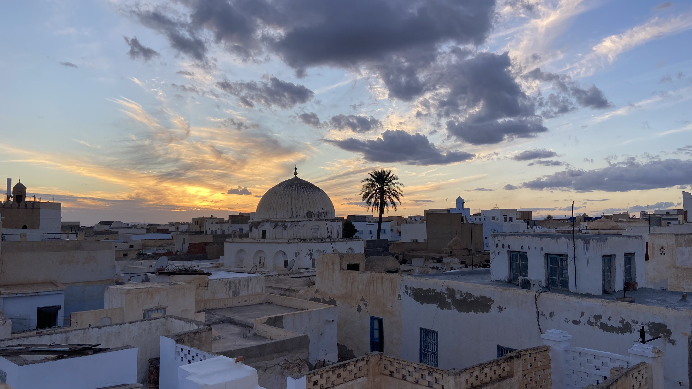{data-gallery="my-gallery"}

We had thought of going to El Jem that evening to see the amphitheatre but there are barely any hotels there. We therefore knocked on the door of [Dar Djamila](https://maps.app.goo.gl/afHgL8qinMoGVYPAA), and Alex (the owner) was so lovely and welcoming and let us stay in the smallest room he had for 20EUR each. It is a beautiful building and a homely stay. Alex makes you feel so welcome, helped us with lots of questions about where we should visit next, and made us a delicious breakfast! He also made us tea that we enjoyed on the rooftop at sunset, overlooking the town. 

!!! info "Alex is available at +216 92 978 220 via WhatsApp for any bookings and is keen to help you with your questions and any logistics or activity planning in Tunisia!"

## Day 3: Douz and the desert via Matmata
We drove from Kerouan down to Douz (4h drive with a pause in Matmata). 

Matmata is very touristy (troglodyte homes). We stopped just before at one of the signposted “maisons troglodytes” and it was a great choice! [Dar Zohra Tijma](https://maps.app.goo.gl/cYe6TwdjWk7ssTRw7): We got a private tour of Mr Tijma’s house, and also bought tea and coffee from him. We tipped him for his visit (customary). Great place to go if you want something authentic and less crowded than where all the tourist buses stop in town. 

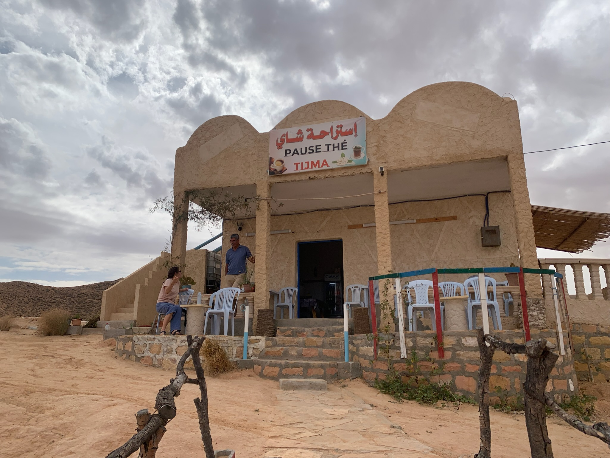{ width="49%" }
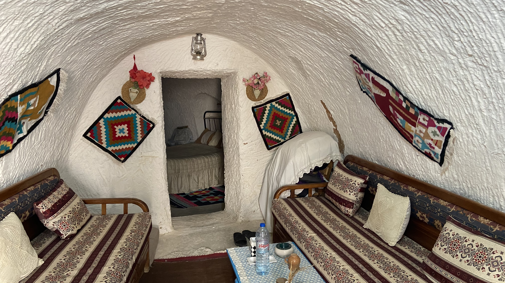{ width="49%" }

We then drove on to Douz and the views were wonderful. We had booked a desert experience 2 days before via WhatsApp with the [Touil Travel Tunisia company](https://maps.app.goo.gl/guD1EJWTkqiLJUTJ9). This was 70 EUR per person and included a camelback ride to a camp for the night, dinner, a tent bed, breakfast and the ride back. We arrived and everything was sorted for us already, we were whisked away by their car to the meeting point to meet our guide and camels (our car stayed parked in a locked parking at the tour operator’s house). 

The camel ride was very good fun. We’re also no animal experts but they seemed well fed and we saw they were well taken care of during the stay. The ride was about 1h30 long, and we had time upon arrival at the camp to watch sunset from a dune nearby. They let you walk around pretty freely. 

They showed us how to make bread under the sand and embers. We then had dinner and they played songs for us by the fire (all very touristy, but nice to spend some time by the fire in any case). We were very lucky and only had one person with us on the tour, but the camp fits 32 so if you go in high season you could be at a pretty crowded spot! 

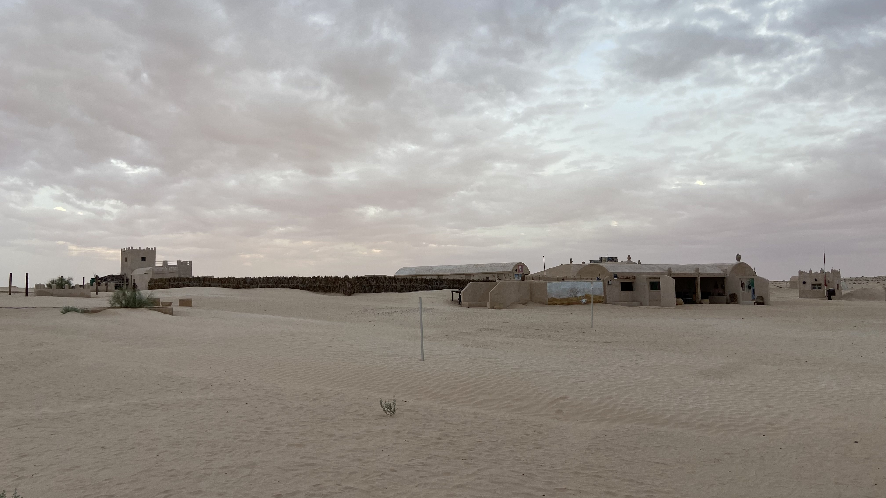{ width="49%" }
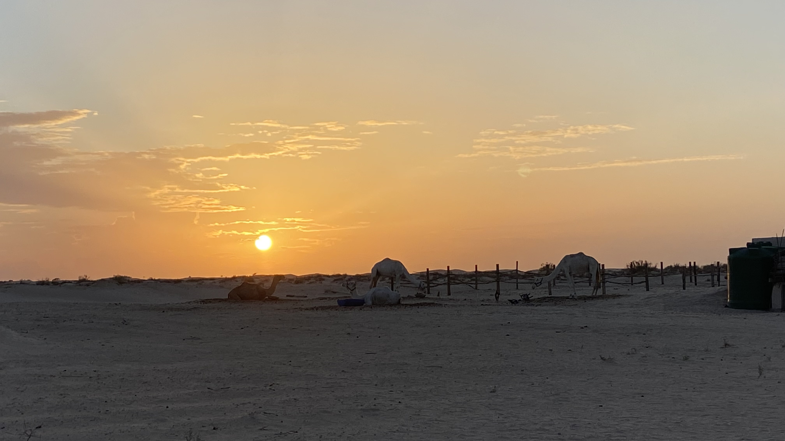{ width="49%" }

## Day 4: To El Jem via Chott El Jerid, and Mahdia 
In the morning we headed back on camelback to where we had been dropped off and got driven back to our car. NB: We saw a lot of people quad biking and riding camels- these are options too if you don’t want to sleep overnight at the desert camp. We picked up some cash and started the long drive to El Jem via Chott El Jerid (1h to Chott El Jerid from Douz and 3h30+ to El Jem after, and another 45 mins to Mahdia from El Jem). 

Chott El Jerid was nothing special. I think it might be better at sunset/sunrise but it sort of looked like a desert to us. Wouldn’t particularly say it was worth the detour. 

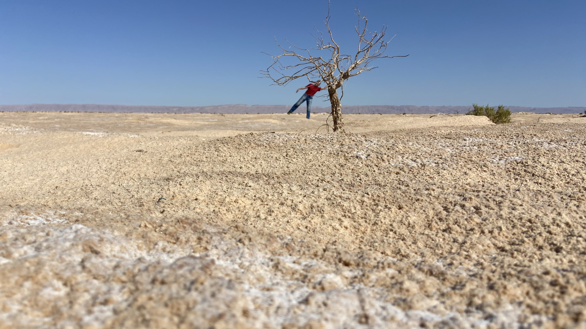

We stopped at [El Hamma](https://maps.app.goo.gl/bBsi6LGmHt5WGsd78) for a quick chapati lunch and bought some dates (5TND for a kilo, someone told me locals get them for 1-2 TND for a kilo). 

El Jem amphitheatre was spectacular, especially at golden hour. 20 TND per ticket. Well worth the visit! We drove on to Mahdia for the night. 

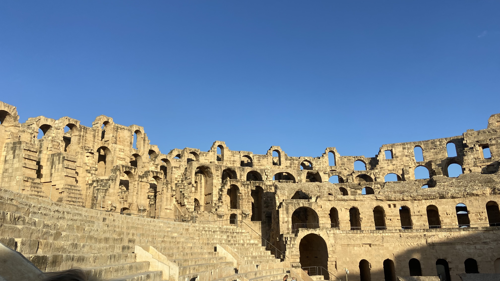

## Day 5: Mahdia

Mahdia is a resort town like its neighbours Monastir and Sousse but, according to a few locals we spoke to, much smaller and likely less busy (in October we saw some people but not huge crowds). 

It was windy and sea was choppy so we walked to the other side of town for a swim. We passed through [Cap Afrique](https://maps.app.goo.gl/7fw5uh1CqS9EZBgy8) at the tip of the city, which was beautiful, and then settled down at [Café Sidi Salem Elghar](https://maps.app.goo.gl/WC262jehA2P4ikP79). They have a small staircase down to a crystal clear but small rocky bay where you can swim if you’re having something to eat/drink. Worth the 6 TND we spent on ice cream there. We also had lunch at [Chez Naima](https://maps.app.goo.gl/jBD8twyT1W8v2ZfN7). This was a great experience! We had fresh prawns and rice, and a veggie option: shakshuka, all for 25 TND. The other local place we had looked at was [Oklet Zemen](https://maps.app.goo.gl/taiqMG41sQhwDo5W9) which looked a bit more upscale but delicious and still very fairly priced. However for this one you need to call the day before to reserve - locals love it and the cook only makes a set number of dishes per day for those who have reserved! 

We stayed in an apartment [here](https://www.booking.com/hotel/tn/mahdia-front-sea-2.fr.html?aid=356980&label=mkt123sc-6ec72b2d-dbd2-4ebd-999c-1d43a398aa73&sid=dcfb1164d3f7d35d911f62685d8651d8&dest_id=-725773&dest_type=city&dist=0&group_adults=2&group_children=0&hapos=1&hpos=1&no_rooms=1&req_adults=2&req_children=0&room1=A%2CA&sb_price_type=total&sr_order=popularity&srepoch=1792144848&srpvid=7c314665b8e306a3&type=total&ucfs=1&) for 35 euros per night. It was a good location (sea front) and only 40 minutes from the old town but in October felt slightly quiet. Prices were in October so might be higher during summer. Maybe centre of town would have been more lively (seemed it in the evening). 

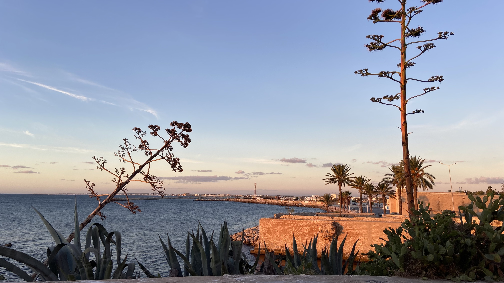{ width="49%" }
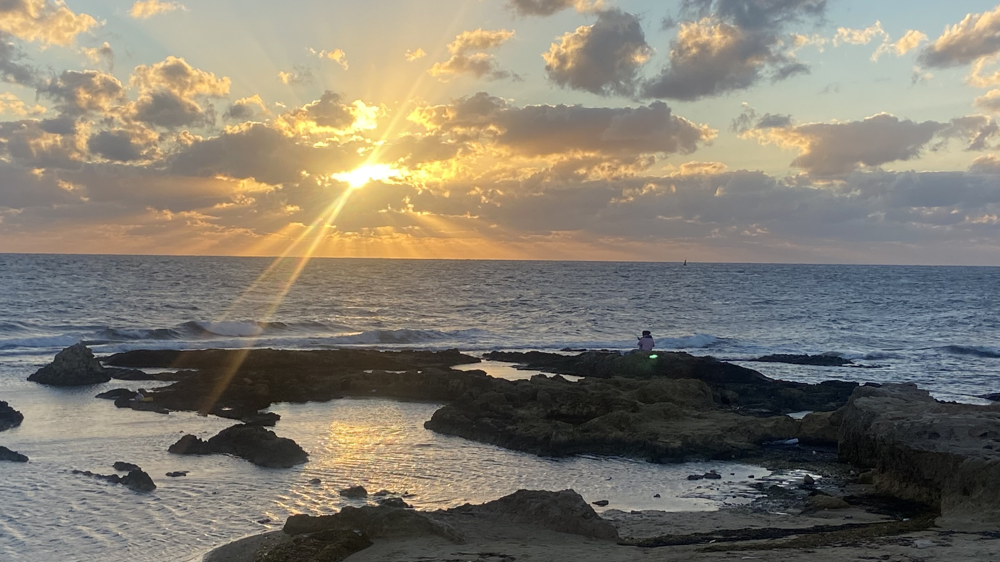{ width="49%" }

## Day 6: Back to Tunis
We left Mahdia after a morning swim at 9 and made it to Tunis by 11:45 just in time for a hammam before heading to the airport. We chose this one: [Hammam Sidi Sahbi](https://maps.app.goo.gl/e62YEn7k3oy1QRA99). It was very local but a lovely experience. The women took great care of us (scrub and shampoo for 30 TND per person- likely tourist pricing but still very fair). We stayed in the steam room for about 10 minutes and then went on to be scrubbed and washed. The hygiene of the place is okay- but definitely don’t go here if you’re looking for an upscale experience. It’s pretty basic but very fun! We were out again 35 minutes later, which gave us enough time for a short walk through the medina. From what we saw it was beautiful but quite crowded and was a lot of souvenir shops. 

## Tips and other info
- SIM cards: we bought ours from Orange [here](https://maps.app.goo.gl/43WDt1n7P7Eh9xuM8). It was 20 dinars each for 8 GBs and the SIM activation. Ooreedoo has a shop just around the corner that would likely be fine too (noticed some locals used this instead). 
- Driving and police: Driving in Tunisia can be hectic but mostly was fine. Slightly more chaos in the centres of town but the highway was very calm. All roads are of good quality (the ones we took). Lots of police checkpoints but they didn’t stop us most of the time (got stopped once in four days), and waved us on when they saw we were foreigners.
- Food and hygiene: We didn’t feel ill a single time despite being warned, but the harissa sauce can be very spicy.. You've been warned! 
- Cash and banks: STB was the best value for money (ATM fees), 400 TND max take out and a 10 TND fee. We tried another but it was also 10 TND and 300 TND max. You can pay in euros at some hotels/for some big tours but Dinars mostly and nowhere really takes card except supermarkets like Carrefour/fancier places and not outside of Tunis. 
- WhatsApp: Again, WhatsApp is king/queen in Tunisia! Most numbers listed on google maps are available on WhatsApp and we found everyone to be very responsive. 

- One of us is fluent in French and speaks a little bit of Arabic. The French was very useful as it is the second most spoken language in Tunisia. The arabic also helped with getting around when not near the coast/Tunis (Centre and South of the country/more rural areas generally speak less French). English was spoken mostly by younger people (30/25 years old and under). 

- For prices and weather purposes: this trip was done in October 2026. 

## Our view on our travels
Travelling comes with privilege. We travel with our money, education, cultural and social understandings and norms. When we leave the "beaten path" and choose to travel further away from the established tourist trail through countries, we end up in places where economies and social structures are not necessarily prepared to receive us. It is important in those moments to remember that we are guests and to respect the values, norms and traditions of the place we are in. We are also a guest of nature and must leave no trace wherever we go. We have tried as much as possible to abide by this wherever we have gone and hope that wandering through these places you will too. Being kind and open-minded goes a long way!

### Comments
You can add some comments on Reddit here, or use the github discussions comment section too.

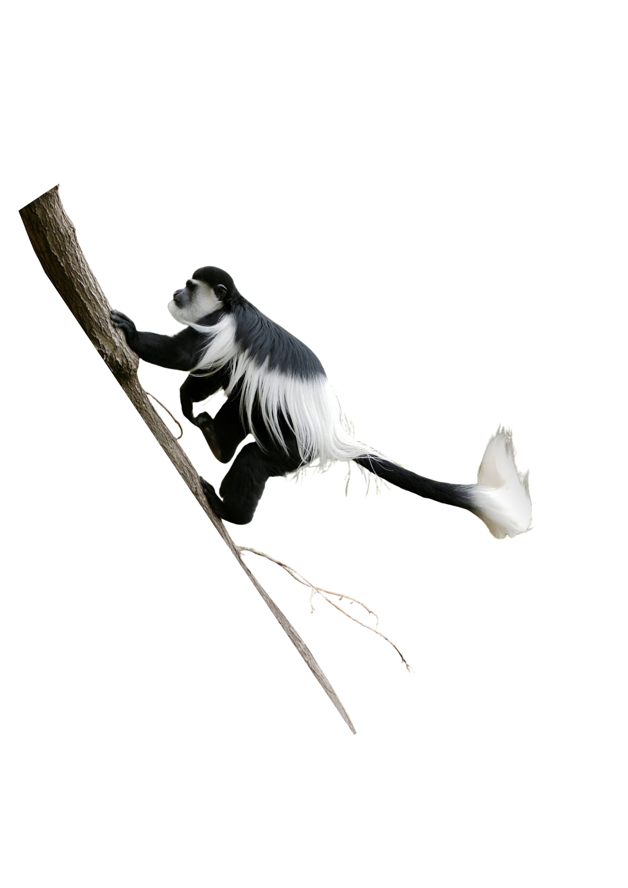{ .side-animal .side-left .side-mid loading=lazy style="width:11rem; top:2rem;left:-9rem"}
